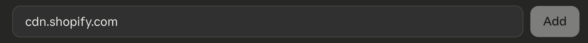
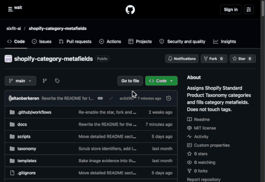
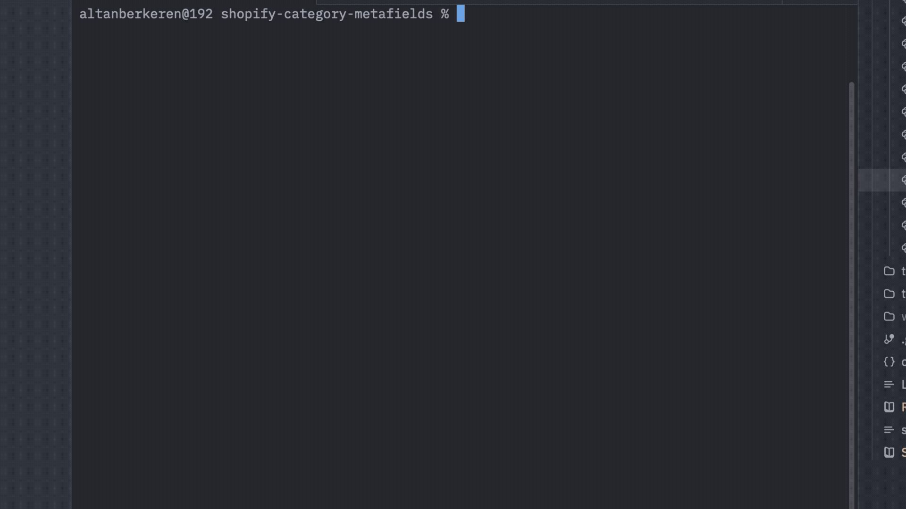
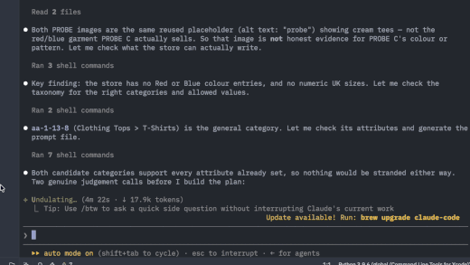
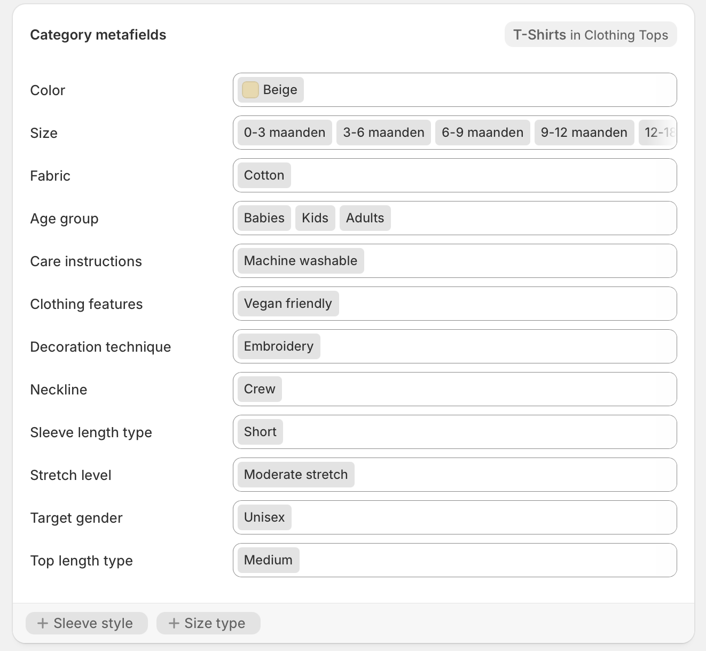

# Shopify Product Categories & Product Details

**What this does:** it goes through your Shopify products, gives each one the
correct **product category** from Shopify's own official category
list, and then fills in the **product details** that category expects: colour,
size, fabric, neckline, sleeve length, care instructions, age group, and so on.

Storefront filters, Google Shopping, Meta catalogs and Shopify search all read
these fields, and on most stores they are empty. Filling them in by hand takes
days. This does it in one conversation with Claude, in ordinary English. You
see everything before it is written, you approve it, and you can undo it.

---

## What you need before you start

**1. A Shopify store you have admin access to.**

**2. Claude, with the Shopify connector switched on and connected to that
store.** The connector is the official Shopify connection inside Claude. Claude
does all the reading and writing through it, using your own Shopify
permissions. There is no API key to create, no app to install in Shopify, and
nothing to paste anywhere.

**3. Two settings in Claude.** Open **Settings > Capabilities** and scroll to
**Code execution and file creation**:


- **Cloud code execution and file creation** is on. Skills need it.
- **Allow network egress** is on, and under **Additional allowed domains** you
  have added `cdn.shopify.com`, then pressed **Add**.



The second one matters: Claude downloads your product photos from
`cdn.shopify.com`, and without it every download fails. Some details, `Pattern`
above all, appear only in the photo.

You do not need to install Python or anything else. The helper scripts run on
Claude's side, where Python is already there.

**4. Time.** For a first run on a few hundred products, set aside an hour. Most
of that is you reading the plan. The writing itself takes minutes.

**Strongly recommended for a first run:** point it at a Shopify **development
store**, or ask it to work on a handful of products only, before you let it near
your whole catalog.

---

## How it works

### 1. Install and verify

**Install**

1. Download `shopify-category-metafields.skill` from the
   [Releases page](../../releases): click the newest release, then the file
   under **Assets**. It is a zip file with a different name, so your browser
   may warn you about an unfamiliar file type. That is expected.
2. In Claude, open **Customize > Skills** and upload the file.
3. In Claude's connector settings, turn on the **Shopify** connector and log in
   to your store.

 Skills" width="520">

**Verify**

- The skill is listed under **Customize > Skills**.
- Ask Claude "Which Shopify store are you connected to?" It should answer with
  your store's name.
- `cdn.shopify.com` is listed under **Settings > Capabilities > Additional
  allowed domains**.

### 2. Run the prompt

Tell Claude what you want in ordinary English. It confirms your store, reads
your catalog and your store's settings, and fetches your product images itself.
You don't run anything. The photos are evidence: some details, `Pattern` above
all, appear only in the picture.



Any of these work:

> Categorise my products and fill in their details.

> The filters on my storefront don't work. Can you fix the product data behind
> them?

For a careful first run:

> Start with just the 10 products in my "Tees" collection so I can see what you
> do before we run the whole catalog.

### 3. Answer the questions

You see every proposed category and value, with where each one came from, and
approve them. Nothing is written to your store before this point.



### 4. Metafields are written

The categories and product details are written, checked against the plan, and
show up in your Shopify admin.



### 5. Get your score

Check how complete your product data is now at
[sixfit.ai/metafield-check](https://sixfit.ai/metafield-check).

---

## Undoing a run

In **the same conversation** as the run, ask Claude:

> Undo the run.

It shows you the exact reverse of what it did and runs it once you confirm.

The backup it undoes from lives only inside that conversation. A new
conversation starts empty and has no backup to undo from, so keep the
conversation open until you are sure you are happy with the result.
[How a run works](docs/how-a-run-works.md#undoing-a-run) covers what can and
cannot be put back.

---

## What it will never do

- **Touch another app's data.** Anything outside Shopify's own standard
  fields, such as your Meta channel's fields, your reviews app or your own
  custom fields, is reported to you as skipped and left exactly alone.
- **Invent a value.** Every value comes from Shopify's own list, at one pinned
  version. A value that is not on that category's allowed list is rejected
  outright, not rounded to the nearest thing.
- **Guess.** An attribute your product does not evidence is left empty and
  reported. (You can configure a fallback instead, see [Settings](docs/settings.md).)
- **Change store-wide settings on its own**, or as a side effect of anything else.
- **Write anything before a verified backup exists.**
- **Rename, translate, or reword your existing values.**
- **Use the one Shopify operation that could wipe your other apps' data.** See
  [For developers](docs/developers.md#safety-rules-built-into-the-code).

---

## More documentation

- [How a run works](docs/how-a-run-works.md): the four phases, the three
  approvals, and undoing a run.
- [Settings](docs/settings.md): what you can change in `config.json`.
- [Troubleshooting](docs/troubleshooting.md)
- [Frequently asked](docs/faq.md)
- [Concepts](docs/concepts.md): the terms used in the plan, and how a value is
  stored in Shopify.
- [For developers](docs/developers.md): the scripts, the safety rules in the
  code, the taxonomy index, and known limits.

---

## Using Claude Code instead

The steps above are for Claude in the browser and the desktop app. In Claude
Code (the terminal version) three things differ:

- **Install:** unzip the bundle into your skills folder and restart Claude Code.
  ```
  unzip ~/Downloads/shopify-category-metafields.skill -d ~/.claude/skills/
  ```
- **Python:** the helper scripts run on your own computer, so you need
  Python 3.8 or newer there. Check with `python3 --version` (`python --version`
  on Windows). If it is missing, install it from
  [python.org/downloads](https://www.python.org/downloads/) and, on Windows,
  tick "Add Python to PATH". No extra packages are needed.
- **Network and undo:** the `cdn.shopify.com` setting does not apply, and the
  backup is saved as a file in the skill's folder, so you can undo from a later
  session too.

---

## Licence

MIT.
